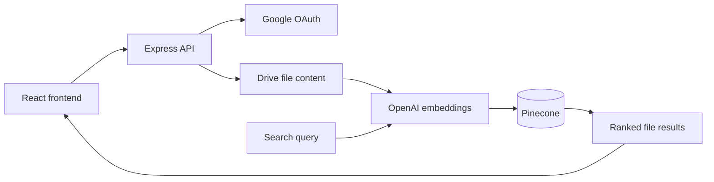

# Google Drive Semantic Search

**Find documents by what they mean, not only by their filenames.**

A full-stack prototype that connects Google Drive file selection to embedding generation and vector search. React handles sign-in and search screens; an Express server integrates with Google OAuth, Drive, OpenAI, and Pinecone.

## How it helps

A remembered idea is not always an exact keyword. This project explores retrieving relevant files from a natural-language query, while showing the boundaries between authentication, document ingestion, and retrieval.

## Implemented components

- Google OAuth URL and callback handlers.
- Drive file listing and selected-file ingestion.
- Embedding generation and Pinecone upserts.
- Query embedding, similarity search, and result presentation.
- Frontend screens for login, file selection, and search.

## Run the development services

Use Node.js/npm and your own Google OAuth, OpenAI, and Pinecone accounts. Download the source and start these processes in separate terminals.

**Frontend, from the repository root:**

```bash
npm install
npm run dev
```

**Backend, from the repository root:**

```bash
cd server
npm install
npm run dev
```

Vite is configured for **port 8080**. The API defaults to **port 3001** with an `/api` prefix. The frontend lives at the repository root, not in a `client/` directory.

## Configuration and integration status

The server reads `GOOGLE_CLIENT_ID`, `GOOGLE_CLIENT_SECRET`, `GOOGLE_REDIRECT_URI`, `OPENAI_API_KEY`, `PINECONE_API_KEY`, `PINECONE_ENVIRONMENT`, `PINECONE_INDEX`, and optional `PORT` from its environment.

The frontend API base is `VITE_API_BASE_URL`, defaulting to `http://localhost:3001/api`. Review [`vite.config.ts`](vite.config.ts) and [`src/lib/constants.ts`](src/lib/constants.ts) when configuring the browser build. Provider secrets belong on the server; the current frontend contains legacy provider configuration that should be removed before distribution.

This is an integration prototype: the callback request in `src/lib/api.ts` uses **POST**, while `server/server.js` registers a **GET** callback. Align that contract, redirect URLs, and browser origins before expecting a complete sign-in flow. The committed Pinecone SDK configuration also needs compatibility review against the installed SDK.

## Architecture



## Source guide

| Location | Purpose |
|---|---|
| [`server/server.js`](server/server.js) | OAuth, Drive, ingestion, and retrieval endpoints |
| [`src/lib/api.ts`](src/lib/api.ts) | Browser API requests |
| [`src/lib/constants.ts`](src/lib/constants.ts) | Client configuration |
| [`src/pages/`](src/pages) | Login, dashboard, and search screens |

## References

[Google OAuth](https://developers.google.com/identity/protocols/oauth2) · [Drive API](https://developers.google.com/drive) · [Pinecone](https://docs.pinecone.io/) · [OpenAI API](https://platform.openai.com/docs)

Created by [Kelavath Balaji Naik](https://github.com/Balaji91221).
